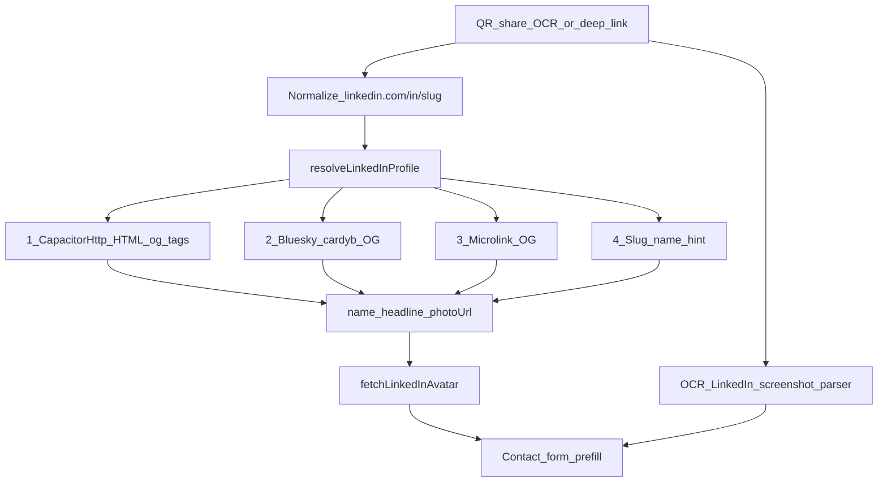

# RememberMe — architecture notes

Local-first conference CRM. Next.js static export + Capacitor (Android/iOS), Dexie/IndexedDB on device. No backend for contacts.

This note focuses on the hard problem we solved: **getting a real display name and profile photo from a LinkedIn URL** (QR, share sheet, or OCR’d screenshot), without an official LinkedIn API.

---

## Stack (short)

| Layer | Choice |
|-------|--------|
| UI | Next.js 16 App Router, static export → `out/` |
| Native shell | Capacitor 8 (Android committed; iOS via `native/ios/` + Mac) |
| Storage | Dexie (IndexedDB) — contacts, photos as blobs |
| Badge / screen text | Tesseract.js OCR on-device |
| QR | jsQR on camera frames / stills |
| Deep links / share | `rememberme://add?linkedin=…` (+ Android `ACTION_SEND`, iOS Share Extension) |

---

## How LinkedIn name + photo are extracted

LinkedIn does **not** expose a public “get profile by URL” API for third-party apps. Most `/in/…` pages are **authwalled** for anonymous clients (HTML is a login shell, not the profile). So we use a **fallback chain** of Open Graph / preview extractors, then OCR / share-text / slug hints when the network path fails.

### Entry points (all end in the same resolvers)

1. **LinkedIn QR** — decode URL → skip OCR on the QR bitmap → `resolveLinkedInProfile` + `fetchLinkedInAvatar`
2. **System share** (LinkedIn/Chrome → RememberMe) — Android rewrites `ACTION_SEND` text into `rememberme://add?linkedin=…&text=…`; iOS Share Extension does the same. Share body often includes **name + headline + URL**; we parse those hints in `lib/routes.ts`
3. **Screenshot / camera of a profile on another phone** — Tesseract OCR (`lib/photos/badge-ocr.ts`) with a LinkedIn-specific parser; if a URL appears in the text, merge with live lookup
4. **Deep link / paste** — same as share once we have a clean `/in/slug` URL

Core modules:

- [`lib/photos/linkedin-profile.ts`](lib/photos/linkedin-profile.ts) — name (+ headline, og image URL)
- [`lib/photos/linkedin-avatar.ts`](lib/photos/linkedin-avatar.ts) — download + validate headshot blob
- [`lib/photos/badge-ocr.ts`](lib/photos/badge-ocr.ts) — screenshot / camera OCR
- [`lib/routes.ts`](lib/routes.ts) — share text → URL + name/title hints → `/contacts/new/?…`



### Name resolution (`resolveLinkedInProfile`)

1. **Normalize URL** — strip tracking query params; canonicalize to `https://www.linkedin.com/in/{slug}/`
2. **Cache** — successful names cached in `localStorage` (`rememberme:linkedin-profile:v3:`)
3. **Try sources in order** (each time-bounded):
   - **Native HTML** (`CapacitorHttp`): parse `og:title` / page title / `og:image` when LinkedIn returns real markup (uncommon for private profiles)
   - **Cardyb** (`https://cardyb.bsky.app/v1/extract?url=…`): free OG extractor; works for **public** profiles; authwall → treat as private
   - **Microlink**: last resort (strict free-tier rate limits)
4. **Parse titles** like `Jane Doe - Product Manager | LinkedIn` → name + headline (`parseLinkedInTitle`)
5. **If still no name** — `nameHintFromLinkedInUrl`: split vanity slug (`jane-doe-123` → “Jane Doe”), using common first/last lists for jammed slugs (`janedoe`). Opaque IDs (`ACoAA…`) are not guessed
6. **Private profiles** — set `privateProfile`; UI asks for manual name; OCR / share-text name is preferred over a weak slug guess when both exist

### Photo resolution (`fetchLinkedInAvatar`)

1. Prefer **`photoUrl`** from the profile lookup (usually LinkedIn `media.licdn.com` via `og:image`)
2. **Unwrap** preview proxy URLs when needed (`unwrapPreviewImageUrl`)
3. Fallbacks: unavatar LinkedIn endpoints (`fallback=false`)
4. **Reject logos** — tiny SVG/PNG, small dimensions, LinkedIn brand sprites (common unavatar failure mode)
5. Compress accepted headshots for Dexie storage

Native downloads use `CapacitorHttp` with `arraybuffer` so CORS does not block `media.licdn.com`.

### Screenshot / camera OCR (no URL required)

Photographing someone’s LinkedIn UI (or a screenshot) does not always expose a URL. We:

1. Preprocess (upscale + mild contrast) for phone-screen sharpness
2. Detect LinkedIn chrome (`Connect`, `Message`, `1st`/`2nd`, Highlights, etc.) even when OCR misses the word “LinkedIn”
3. **Strip UI glued to names** — e.g. `Gauri Rao # © 1st`, `Jane Doe · 1st`, pronouns — before name scoring
4. **Never treat chrome as identity** — “Show details”, “Highlights”, etc. are denylisted
5. Score header-area person-name candidates (prefer name sitting above a headline)
6. If a URL is OCR’d, run the same `resolveLinkedInProfile` / avatar path and merge (public OG name wins; private → keep OCR name)

Camera shutter and gallery upload share this path (`finishWithBadge` / `extractBadgeInfo`).

### Share sheet extras

LinkedIn’s Android/iOS share body is often:

```text
Name
Headline
https://www.linkedin.com/in/slug/
```

We keep **`text=`** on the deep link (not only `linkedin=`), parse name/title hints client-side, then still run live lookup for photo + better name when the profile is public.

---

## Android / iOS share wiring

- **Android**: `ACTION_SEND` `text/plain` on `MainActivity` → rewrite to `rememberme://add?…` so Capacitor `App.getLaunchUrl` / `appUrlOpen` fire ([`android/.../MainActivity.java`](android/app/src/main/java/com/rememberme/app/MainActivity.java))
- **iOS**: Share Extension sources under [`native/ios/`](native/ios/); wire in Xcode per [`native/ios/README.md`](native/ios/README.md)

---

## What still fails (by design / LinkedIn limits)

- **Private / authwalled** profiles: no reliable name or photo from the network; slug hint or OCR/share text only
- **Microlink quota**: avoid depending on it; cardyb covers most public cases
- **Official API**: would require LinkedIn partner access; not used in v1

---

## Key file map

| Concern | Path |
|---------|------|
| Profile name / OG | `lib/photos/linkedin-profile.ts` |
| Avatar download | `lib/photos/linkedin-avatar.ts` |
| Badge + LinkedIn screen OCR | `lib/photos/badge-ocr.ts` |
| QR + frame capture | `lib/photos/badge-qr.ts` |
| Share / deep link routing | `lib/routes.ts`, `components/providers/cap-app-provider.tsx` |
| Capture UI | `components/contacts/capture-first-screen.tsx` |
| Form autofill | `components/contacts/contact-form.tsx` |
| Reminders (≤1×/day when overdue) | `lib/notifications/reminders.ts` |
